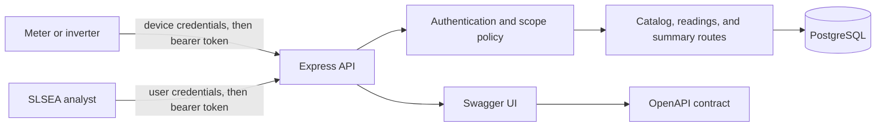
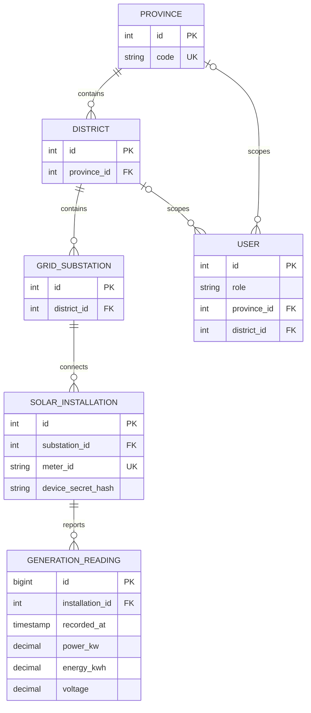

# Architecture and verification notes

This is implementation documentation for development and viva preparation, not report prose.

## Runtime boundaries

The API is a single deployable service. Express handles HTTP representation and routing; authentication resolves the bearer principal from PostgreSQL on each request; scope predicates restrict reads in SQL; PostgreSQL enforces foreign keys, uniqueness, and numeric constraints. The host must terminate public HTTPS. Docker Compose supplies a local API and database only.

## Data model

The meter ID stays on SolarInstallation. GenerationReading is immutable through the API; `(installation_id, recorded_at)` is unique, and the index on installation/time supports latest and history queries. A User has either a province or district jurisdiction when its role needs one.

## Main request flows

1. **Ingestion:** the meter exchanges its ID and private secret for a 15-minute JWT; the API rechecks that the installation is active, verifies the target installation ID, validates measurements, inserts one row, and returns `201` with its canonical `Location`. A duplicate timestamp returns `409`.
2. **Analytical read:** an analyst receives a JWT; every history request verifies the active user, applies the user's jurisdiction in SQL, then applies optional time bounds, counts filtered rows, and retrieves one sorted page. Out-of-scope atomic resources return `404`.
3. **Operational read:** latest-reading and district-summary routes derive current views from immutable readings. The summary counts only sites with a reading within 30 minutes as fresh; day boundaries use Asia/Colombo. These time-sensitive representations use ETags, not Last-Modified, because their freshness fields change with time.
4. **Catalog maintenance:** an administrator can create, replace, patch, and delete metadata. `PUT` requires the complete public mutable representation; `PATCH` accepts selected fields; `If-Match` protects both updates and deletes. Foreign keys block deleting parents that still have children or history.

## Failure points and controls

| Failure | Current control | Operational response |
| --- | --- | --- |
| PostgreSQL unavailable | `/health` queries the database; API errors are structured | Restore the persistent database before directing traffic |
| Stolen/expired bearer token | 15-minute expiry; server checks current principal status | Disable the principal or rotate the JWT signing key to revoke issued tokens; issue fresh credentials |
| Cross-jurisdiction access | SQL scope predicate and atomic 404 | Investigate auth and scope logs; extend matrix tests |
| Duplicate or invalid reading | Unique constraint, Zod validation, capacity tolerance | Device should correct invalid values and avoid retrying accepted timestamps |
| Meter outage | Last-known timestamp, stale flag and stale-site count | Consumers should show age and avoid treating synthetic data as live |
| Large history query | Indexed time path, page size at most 100 | Add keyset pagination or partitions when real scale demands them |

## Deferred scaling choices

At the coursework seed scale, one PostgreSQL database and indexed tables are sufficient. At national telemetry scale, partition readings by time, use keyset pagination for deep history, move aggregate refreshes to a controlled background job if query latency rises, and instrument ingestion/error rates. These are follow-on changes, not claims about the current implementation.
